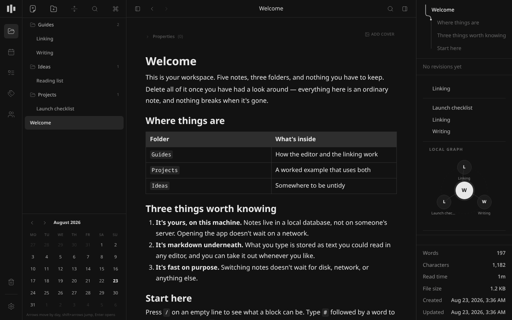

<p align="center">
  
</p>

<h1 align="center">Skriuw</h1>

<p align="center">
  <em><strong>skriuw</strong> (verb)<br />
  /skrɪu̯/, Frisian, "to write."</em>
</p>

<p align="center">
  A local-first notes app for writing, journaling, and linking notes together.<br />
  It runs offline on macOS, Windows, and Linux and needs no account.<br />
  Signing in turns on sync and lets you continue in the browser,<br />
  which runs the same Rust core compiled to WebAssembly.
</p>

<p align="center">
  
  
  
  
  
  
</p>

<p align="center">
  
</p>
<p align="center">
  <sub>The browser build at <a href="https://skriuw.com/app">skriuw.com/app</a>, driven from the keyboard, captured in real time and uncut. The desktop app is the same renderer on the same Rust core.</sub>
</p>

Your workspace is a SQLite database on your machine. Typing updates the screen in the same frame, without waiting for the disk, a server, or an account. A browser build runs at [skriuw.com/app](https://skriuw.com/app) without an install. It lacks some desktop features, listed in the [platform table](docs/FEATURES.md#mobile-app-ios-and-android).

- A rich-text editor that saves Markdown
- `#` tags, `$` people, and `@` note links. Renames update every link, and each note shows its backlinks
- A Git history of every save, written in the background, and scheduled backups that are verified before they count
- Imports from Obsidian, Notion, Bear, Apple Notes, and plain Markdown
- A command palette and rebindable shortcuts. Sync stays off until you sign in
- Nine themes (Skriuw, Paper, Embers, Catppuccin Mocha and Latte, Rosé Pine Dusk and Dawn, Gruvbox, Tokyo Night) and sans, serif, or mono editor type
- AI writing tools that stay off until you enable them. They run against a local Ollama model or with your own Anthropic, OpenAI, OpenRouter, Gemini or Groq key

The journal, tabs, split view, flowcharts, properties, and trash are in
[FEATURES.md](docs/FEATURES.md). [ARCHITECTURE.md](docs/ARCHITECTURE.md)
describes how it is built, and
[docs/performance-contract.md](docs/performance-contract.md) defines the
latency budgets it is held to.

## Installation

The [latest GitHub release](https://github.com/remcostoeten/skriuw/releases/latest)
has installers for macOS, Windows, and Linux (`.dmg`, `.exe`/`.msi`, `.deb`,
`.rpm`, AppImage).

### Debian / Ubuntu (APT)

```bash
curl -fsSL https://skriuw.github.io/packages/apt/key.gpg \
  | sudo gpg --dearmor -o /usr/share/keyrings/skriuw.gpg
echo "deb [signed-by=/usr/share/keyrings/skriuw.gpg] https://skriuw.github.io/packages/apt stable main" \
  | sudo tee /etc/apt/sources.list.d/skriuw.list
sudo apt update && sudo apt install skriuw
```

### Fedora / RHEL (dnf)

```bash
sudo dnf config-manager addrepo --from-repofile=https://skriuw.github.io/packages/rpm/skriuw.repo
sudo dnf install skriuw
```

### macOS (Homebrew)

```bash
brew install --cask skriuw/tap/skriuw
```

### Windows (winget or Scoop)

```powershell
winget install RemcoStoeten.Skriuw
```

```powershell
scoop bucket add skriuw https://github.com/skriuw/scoop-bucket
scoop install skriuw
```

### Arch Linux (AUR)

```bash
yay -S skriuw-bin
```

### Any Linux (Flatpak)

```bash
flatpak remote-add --if-not-exists --user skriuw https://skriuw.github.io/flatpak/skriuw.flatpakrepo
flatpak install --user skriuw com.skriuw.Skriuw
```

The Flatpak keeps its data under `~/.var/app/com.skriuw.Skriuw`, separate from a native install.

### Nix

```bash
nix run github:skriuw/nix
```

### Browser app in a container

```bash
docker run --rm -p 8080:80 ghcr.io/remcostoeten/skriuw-web:latest
```

Open `http://localhost:8080`. The app needs a secure context for its service
worker and local database, so serve it from `localhost` or over HTTPS. Set
`SITE_ADDRESS` to a domain and publish ports 80 and 443 to get automatic HTTPS.
Sync stays off until you sign in, and sign-in talks to the hosted Skriuw cloud.

### iPhone and Android

The mobile client is not published yet. A native client exists in
[`apps/mobile/`](apps/mobile). It uses the same Rust core, editor, and
workspace as the desktop app, and has notes, journal, tasks, locked notes, and
end-to-end encrypted sync. It has never been submitted to either store, and iOS
has never been launched on a device. What is built, what is measured, and what
blocks a first TestFlight and Play internal-track build are in
[`tools/packaging/mobile`](tools/packaging/mobile/README.md).

Until then, [skriuw.com/app](https://skriuw.com/app) installs to a home screen
from the browser and works offline.

## Privacy

**Nothing syncs unless you sign in.** Sync is off until you create an account
and turn it on, on desktop and in the browser alike. Until then your notes
never leave the machine they were written on. The desktop app keeps them in
local SQLite, and the browser app keeps them in your browser's own storage.
The exception is a public note link, which stores the note's text and images on
Skriuw's server without end-to-end encryption.

The standalone app does not send workspace content or telemetry. The marketing
site uses Spoar for page views and a few click events.
The desktop app's network code is limited to the sync Worker, which runs only
while you are signed in, and the updater's version check.

The AI features are off until you enable them in settings. They can run against
a local Ollama model, so prompts stay on your machine. Remote providers
(Anthropic, OpenAI, OpenRouter, Gemini, Groq and others) run only with your own API key and only after a per-provider
consent that shows what text is sent. The key lives in the OS keychain or, on
Linux without a keyring, in memory or a local file you choose. It never goes
into the database or exports.

You can lock individual notes or folders behind a PIN or passphrase. Locked
bodies are encrypted on disk and stay out of search, links, and history until
you unlock them for the session. A one-time recovery code covers a forgotten
secret ([details](docs/adr/0044-locked-notes.md)).

Sync is end-to-end encrypted. Notes, media, and archives are sealed on your
devices with a key derived from a recovery code the server never sees. The
service orders and stores opaque bytes, plus identifiers, sequences, sizes, and
timing ([details](docs/adr/0043-end-to-end-encrypted-sync.md)).

## Development

Rust 1.95, Bun 1.3, Node.js 24, and the platform dependencies required by
Tauri.

```bash
./bin/setup         # install dependencies, generate contracts, and check
./bin/dev desktop   # also: browser | site | mobile
./bin/check         # desktop gate; also: browser | mobile
./bin/build         # Rust workspace; also: desktop | browser | site | ci
```

The repository layout, web deployment, and cloud development reference is in
[docs/development.md](docs/development.md). Contributions start at
[CONTRIBUTING.md](.github/CONTRIBUTING.md). Report security issues through
[SECURITY.md](.github/SECURITY.md) instead of a public issue.

Framework-independent v2 helpers live in [`packages/shared`](packages/shared/README.md).

## Using the previous generation

The previous generation of Skriuw (web, mobile, collaboration, self-hosting)
lives in [`v1-final/`](v1-final) and is frozen at `0.25.0`. You can still install it:

```bash
# source as it shipped, before the move into v1/
git clone --branch v0.25.0 --single-branch \
    https://github.com/remcostoeten/skriuw.git skriuw-v1

# self-host image, pinned to the last v1 version
docker pull ghcr.io/remcostoeten/skriuw:0.25.0
```

Desktop installers for macOS, Windows, and Linux are attached to the
[`desktop-v0.25.0` release](https://github.com/remcostoeten/skriuw/releases/tag/desktop-v0.25.0).
The container image is no longer rebuilt, and `0.25.0` is its final version.

To work on v1 in this repository instead, use `v1-final/` on the current branch, or
`f74af74f` for the last commit that touched it before the freeze. Setup lives
in [`v1-final/README.md`](v1-final/README.md).

<br/>

xxx,<br/>
[Remco Stoeten](https://remcostoeten.com)<br/>
<small>[MIT](LICENSE)</small>

PS: Anthropic sponsored six months of Claude Max through their [Claude for Open Source](https://claude.com/contact-sales/claude-for-oss) program. An abandoned Svelte Markdown project originally inspired Skriuw's UI. I can no longer find it, so if you recognize it, please get in touch so I can give proper credit.
